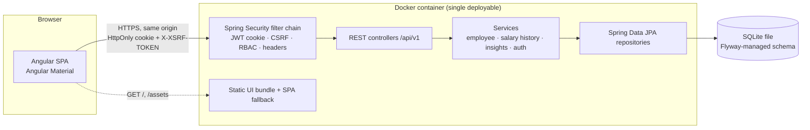
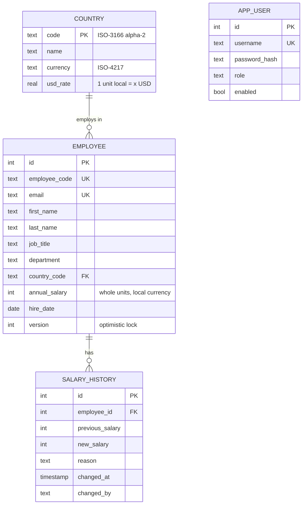

# Architecture & Design Notes

## High-level view



The UI and API ship in **one image and one origin**. That removes CORS from production, lets the
session token live in an `HttpOnly; SameSite=Strict` cookie (not reachable from JavaScript, so XSS
can't steal it), and keeps deployment to a single `docker run`.

## Backend structure (package-by-feature)

```
com.acme.salary
├── SalaryManagementApplication
├── auth        login/logout/me, login throttling, user bootstrap
├── security    filter chain, JWT-in-cookie authentication, CSRF, roles, 401/403 problem responses
├── employee    Employee aggregate, CRUD service, search specifications, REST API
├── salary      SalaryHistory (append-only audit of pay changes)
├── insights    Read-only analytics; pure SalaryStatistics calculator
├── reference   Countries + currency + USD reference rate
├── seed        Deterministic 10k employee generator (opt-in at startup)
└── common      Error handling (RFC 7807), paging DTO, JPA auditing, web/SPA config
```

Package-by-feature keeps each capability cohesive (controller, service, repository, DTOs side by side)
and makes boundaries visible: `insights` only *reads* employees through a projection and never mutates.

## Data model



**Decisions**
- *Money as whole integer units in local currency.* SQLite has no exact decimal type; storing `INTEGER`
  avoids floating-point drift. Annual salaries are negotiated in whole units, so nothing is lost.
- *Currency is derived from country*, not stored per employee — one source of truth, no "INR salary in Germany" inconsistencies.
- *USD normalisation happens at read time* using the `country.usd_rate` reference table, so changing a rate
  never rewrites salary data.
- *Optimistic locking* (`version`) — two HR users editing the same record get a 409 instead of a silent lost update.
- *Salary history is append-only* and written in the same transaction as the salary change.

## API (v1)

| Method | Path | Role | Notes |
|--------|------|------|-------|
| POST | `/api/v1/auth/login` | public | Sets `ACCESS_TOKEN` HttpOnly cookie; throttled |
| POST | `/api/v1/auth/logout` | any | Clears cookie |
| GET | `/api/v1/auth/me` | any | Current user + role; also primes CSRF cookie |
| GET | `/api/v1/employees?q=&country=&department=&page=&size=&sort=` | viewer+ | Server-side paging; sort whitelist |
| GET | `/api/v1/employees/{id}` | viewer+ | |
| POST | `/api/v1/employees` | manager | 201 + Location |
| PUT | `/api/v1/employees/{id}` | manager | Requires `version`; salary change requires `salaryChangeReason` |
| DELETE | `/api/v1/employees/{id}` | manager | 204 |
| GET | `/api/v1/employees/{id}/salary-history` | viewer+ | Newest first |
| GET | `/api/v1/reference/countries` · `/departments` · `/job-titles` | viewer+ | Drop-down data |
| GET | `/api/v1/insights/summary` | viewer+ | Headcount, payroll USD, avg/median USD |
| GET | `/api/v1/insights/by-country` | viewer+ | Local currency + USD stats |
| GET | `/api/v1/insights/by-department?country=` | viewer+ | USD stats, optional country filter |
| GET | `/api/v1/insights/by-job-title?country=` | viewer+ | Answers "what do we pay X in Y?"; local currency when a country is given |

Errors are RFC 7807 `application/problem+json` with a stable `code` and per-field `errors` for validation.

## Security design

| Threat | Control |
|--------|---------|
| Credential stuffing / brute force | BCrypt (cost 12); per-username lockout after 5 failures for 15 min; generic error message (no user enumeration) |
| Token theft via XSS | JWT in `HttpOnly; Secure; SameSite=Strict` cookie scoped to `/api`; strict CSP (`script-src 'self'`, self-hosted fonts); Angular auto-escaping |
| CSRF | Spring Security CSRF with cookie-to-header pattern (`XSRF-TOKEN` → `X-XSRF-TOKEN`), natively supported by Angular `HttpClient`. The JWT filter is registered manually because `oauth2ResourceServer()` would exempt cookie-borne tokens from CSRF (see decision D9) |
| Open redirect | Post-login `returnUrl` accepted only as an in-app path |
| Log injection | CR/LF stripped from user-supplied values before logging |
| Broken access control | Deny-by-default URL rules + `@PreAuthorize` on mutating endpoints; role comes from signed JWT claim |
| Injection | JPA Criteria / parameter binding only; sort fields whitelisted |
| Mass assignment | Dedicated request DTOs; `id`, audit fields and history never bindable |
| Information leakage | Global exception handler returns sanitized ProblemDetail; actuator exposes only `health` |
| Secrets in source | JWT secret and bootstrap passwords from env vars; `prod` profile fails fast if missing or weak |
| Clickjacking / sniffing | `X-Frame-Options: DENY`, `X-Content-Type-Options: nosniff`, HSTS, `Referrer-Policy` |
| Container | Non-root user, minimal JRE base image |

## Insights computation
Insights load a narrow projection (`country, department, jobTitle, annualSalary`) and compute statistics
in a **pure, unit-tested `SalaryStatistics` class**. Medians are the HR-relevant measure (averages are
skewed by executives) and SQLite has no `PERCENTILE_CONT`, so computing in-process gives exact, portable
results. See `04-performance.md` for the scaling path.
